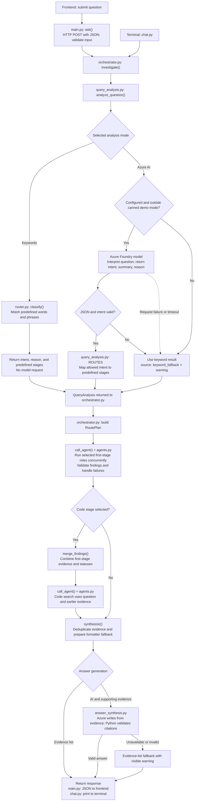

# Keyword and Azure routing flow

[Open the standalone diagram](ORCHESTRATOR_FLOW.svg).

This shows the current implementation. The analysis mode changes how intent is
selected; Python executes the route, then answer generation is chosen independently.

## Supported routes

| Intent | First stage | Second stage |
|---|---|---|
| how_to | Docs | None |
| logs_lookup | Logs | None |
| code_lookup | Docs | Code |
| incident / unknown | Logs and docs together | Code |

- Keyword mode calls router.py through query_analysis.py and makes no Azure request for intent.
  Final answer generation can still use Azure; choose Evidence list to avoid that call.
- Azure mode validates the model output before mapping it to one of these routes.
- The implementation precomputes the keyword result even in Azure mode, so it is
  ready as a fallback. Canned demo mode also bypasses Azure.
- In the default local configuration, docs/code search files and logs is unavailable.
  Actual teammate services and their databases are not connected.
- The input model interprets intent. A separate model call writes from collected evidence
  when AI explanation is selected (default when configured). Python validates citation IDs
  and retains the evidence-list fallback.

For the full implementation and demo checklist, see
[PIPELINE_SUMMARY.md](orchestrator/PIPELINE_SUMMARY.md).
