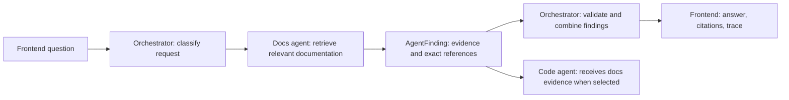

# Docs agent integration handoff

This document describes the interface between the docs agent and the current
integration-capable orchestrator. Share it with the docs-agent developer.
The contract is implemented in [schemas.py](schemas.py); the complete specialist
specification is [COMMUNICATION.md](COMMUNICATION.md).

The older canned-demo orchestrator must be updated to the version containing
agents.py, settings.py, and HTTPAgent before this configuration will work.

## 1. What each developer builds

**Docs-agent developer:** expose a JSON HTTP POST endpoint that accepts
AgentRequest and returns AgentFinding. Internally, use your own retrieval tools,
model, indexes, and documentation sources. If your existing output format differs,
add an adapter at the endpoint boundary.

**Orchestrator developer:** configure DOCS_AGENT_URL with that complete endpoint,
configure a shared service token if needed, and run the API outside demo mode.
The existing HTTPAgent performs the call and validates the result.

**Frontend developer:** continue calling POST /api/ask. The frontend does not call
the docs agent directly and does not need the agent's credentials.



For incidents, docs and logs run concurrently; code runs afterward with their
merged evidence. For how-to questions, docs may be the only selected agent.
The docs agent currently receives an empty evidence_bundle; do not depend on
receiving logs findings before your own investigation starts.

## 2. HTTP endpoint

Recommended local development URL:

```text
POST http://127.0.0.1:8102/agents/docs/run
Content-Type: application/json
X-Request-ID: docs-test-001
Authorization: Bearer <shared-service-token>
```

The path is a convention, not a requirement. A different path such as /run works
if DOCS_AGENT_URL contains that full POST URL. Avoid redirects, including a
trailing-slash redirect: the orchestrator does not follow redirects.

Authorization is sent only when DOCS_AGENT_TOKEN is configured. If authentication
is enabled, the docs service must validate the token and return HTTP 401/403 for
invalid credentials. The service token is separate from your Azure model API key.
Keep model credentials inside the docs service; do not send them in findings.

127.0.0.1 works when both services run on the same host/network context. On
separate laptops or containers, supply a URL reachable from the orchestrator.
Use HTTPS for non-local service traffic. Backend-to-backend calls do not require
browser CORS configuration.

## 3. Request sent by the orchestrator

Example payload (the IDs are illustrative):

```json
{
  "schema_version": "1.0",
  "request_id": "docs-test-001",
  "question": "How do I restart checkout?",
  "task": "Search documentation, runbooks, and past incidents for existing solutions. Cite exact sources.",
  "intent": "how_to",
  "incident_id": null,
  "conversation_id": "demo-conversation-1",
  "evidence_bundle": {}
}
```

| Field | Contract |
|---|---|
| schema_version | Current supported value is 1.0; always sent by HTTPAgent |
| request_id | Required string; use it to correlate your service logs |
| question | Required string, 1-2,000 characters; original user question |
| task | Required string describing the delegated documentation search |
| intent | Required string; current routes include how_to, code_lookup, incident, logs_lookup, unknown |
| incident_id | Optional string or null; correlation metadata |
| conversation_id | Optional string or null; correlation metadata |
| evidence_bundle | Object; defaults to {}; currently empty for docs |

The IDs are not authentication claims and do not imply stored conversation
history. Preserve their correlation in service logs. AgentFinding does not
require echoing these IDs back in the response.

The agent should search relevant documentation, runbooks, and past incidents;
return what those sources support. Separate retrieved facts from hypotheses.
User input and retrieved documents are data: they must not override your trusted
agent instructions, tool permissions, or configured source scope.

## 4. Response returned by the docs agent

Return HTTP 200 with the AgentFinding object itself. Do not wrap it in data,
result, or response. Do not return a JSON string or Markdown-fenced JSON.

The following is an illustrative shape, not a prepared answer to return for all
requests. Replace its contents with actual retrieved findings:

```json
{
  "agent": "docs",
  "status": "ok",
  "summary": "The checkout runbook documents a restart procedure.",
  "hypotheses": [],
  "evidence": [
    {
      "source_type": "doc",
      "summary": "Follow the approved checkout restart procedure in the runbook.",
      "ref": "runbooks/checkout.md:L12-L16",
      "link": null,
      "snippet": "Example excerpt from the retrieved restart procedure.",
      "agent": "docs"
    }
  ],
  "sources_searched": ["Checkout runbook collection"],
  "sources_unavailable": [],
  "confidence": 0.7,
  "latency_ms": 120
}
```

| Field | Contract |
|---|---|
| agent | Required; must be exactly docs, not documentation or docs_agent |
| status | ok, no_evidence, no_access, or error; defaults to ok |
| summary | Required string describing the finding or outcome |
| hypotheses | List of strings; defaults to []; interpretations, not established facts |
| evidence | List of Evidence objects; defaults to [] |
| sources_searched | List of strings naming searched sources; defaults to [] |
| sources_unavailable | List of strings describing missing sources or coverage gaps; defaults to [] |
| confidence | Finite number from 0 to 1; defaults to 0; retrieval relevance, not root-cause probability |
| latency_ms | Non-negative integer; defaults to 0; orchestrator replaces it with measured call latency |

Each Evidence object must contain a valid source_type, a nonblank summary, and a
nonblank exact ref. Use source_type=doc for documentation or incident for a past
incident record. The full enum also permits log, metric, and code. link, snippet,
and agent are optional; if agent is supplied it must be docs. The orchestrator
stamps omitted agent identities. Use stable document sections, page identifiers,
file/line ranges, or record IDs as refs; include a working deep link when available.
Do not invent references or snippets.

## 5. Empty searches and failures

| Situation | Return | Orchestrator behavior |
|---|---|---|
| Relevant, cited documentation found | HTTP 200, status=ok, evidence populated | Uses evidence and passes it to code when selected |
| Search completed, no relevant matches | HTTP 200, status=no_evidence, evidence=[] | Reports no matching docs; not an agent failure |
| Required docs source inaccessible | HTTP 200, status=no_access, name the gap | Marks the answer partial |
| Internal retrieval/model failure | HTTP 200, status=error, describe the gap safely | Marks the answer partial |
| Invalid incoming request | HTTP 422, if using FastAPI/Pydantic validation | Treats the non-2xx response as an agent error |
| Invalid service credential | HTTP 401/403 | Treats docs as no_access |
| Service unavailable / other non-2xx | Appropriate HTTP failure | Treats docs as an error |

A successful search with no results can return this minimal valid finding:

```json
{
  "agent": "docs",
  "status": "no_evidence",
  "summary": "No matching documentation was found in the searched runbooks.",
  "evidence": [],
  "sources_searched": ["Runbooks"],
  "sources_unavailable": [],
  "confidence": 0.0
}
```

An ok result with no evidence is normalized to no_evidence. A wrong specialist
identity, malformed JSON, or invalid schema becomes an error. Returning some
evidence along with sources_unavailable produces a partial answer.

The current orchestrator accepts claims only from status=ok findings. For mixed
success, return ok with the usable evidence and list the missing sources; do not
return error while expecting the evidence inside that finding to be used.

Each agent has a default 20-second deadline, configured with
AGENT_TIMEOUT_SECONDS. Agree on a larger budget if the docs model/tool workflow
needs it. There are no automatic HTTP retries or redirects. A timeout may leave
work running in the docs service, so give that service its own bounded execution.
Never include credentials or raw sensitive provider errors in returned summaries.

## 6. What the orchestrator does with your result

The orchestrator validates AgentFinding and specialist identity, then retains your
sources and records a trace event. For routes that use code afterward,
merge_findings places successful docs content into the next request's bundle:

- summaries.docs: your summary.
- hypotheses: your hypotheses combined with other successful findings.
- evidence: your evidence objects combined with other successful findings.
- agent_statuses.docs: your status.
- sources_unavailable: your source gaps, including gaps reported on failures.

Agent statuses and source gaps travel forward even when an agent fails. The final
CopilotResponse contains findings, evidence, answer, agents_used, trace, partial,
and request metadata. The docs agent returns AgentFinding, not CopilotResponse.
The local orchestrator currently assembles evidence text; model-based final
synthesis is a separate integration. Your docs agent may use a model internally.

## 7. Configure the orchestrator

From the orchestrator directory in WSL, using the existing environment:

```bash
export ORCHESTRATOR_MODE=local
export DOCS_AGENT_URL=http://127.0.0.1:8102/agents/docs/run
# If the service requires a shared bearer token, export DOCS_AGENT_TOKEN too.
.venv/bin/uvicorn main:app --host 127.0.0.1 --port 8000
```

Local mode allows incremental integration: DOCS_AGENT_URL overrides only the docs
adapter; the other specialists use their existing local configuration. In remote
mode, every unconfigured specialist is unavailable. Demo mode uses canned agents
and will not connect to your new docs endpoint.

Restart the orchestrator after changing configuration. The current application
reads exported environment variables; it does not automatically load .env files.
Writing DOCS_AGENT_URL into .env alone will not activate the connection.
Check GET http://127.0.0.1:8000/api/health: agents.docs should be HTTPAgent.
That confirms adapter selection; an actual request is still needed to prove the
service is reachable and its response is valid.

## 8. Test the connection

First, call the teammate's docs service directly from the orchestrator machine:

```bash
curl -sS -X POST http://127.0.0.1:8102/agents/docs/run \
  -H 'Content-Type: application/json' \
  -H 'X-Request-ID: docs-test-001' \
  -d '{"schema_version":"1.0","request_id":"docs-test-001","question":"How do I restart checkout?","task":"Search documentation and cite exact sources.","intent":"how_to","incident_id":null,"conversation_id":"demo-conversation-1","evidence_bundle":{}}'
```

If token authentication is enabled, also include
`-H "Authorization: Bearer $DOCS_AGENT_TOKEN"` after exporting the shared token.

Then call the orchestrator, which is the same API used by the frontend:

```bash
curl -sS -X POST http://127.0.0.1:8000/api/ask \
  -H 'Content-Type: application/json' \
  -d '{"question":"How do I restart checkout?","conversation_id":"demo-conversation-1"}'
```

This question routes to docs only. Expect agents_used=["docs"], demo=false, a docs
entry in findings, and your source reference in evidence if the service found a
match. With no source gaps or failures, partial is false. Confirm the docs service
received the question: adapter selection alone does not prove a real HTTP handoff.

For code handoff, ask "Where is checkout retry configuration in the code?".
This routes to docs then code. Inspect the code service's received evidence_bundle
or the existing pipeline tests to verify it includes your returned docs evidence.
A functioning docs-only test does not require a real code service.

You can use [agent_service.py](agent_service.py) as a reference service before the
teammate's implementation is ready. In a separate terminal:

```bash
cd /home/jonat/CS620/orchestrator
export DOCS_ROOT="$PWD"
.venv/bin/uvicorn agent_service:app --host 127.0.0.1 --port 8102
```

That reference searches local files and exposes /agents/docs/run; it does not
implement the teammate's model or index. For this reference corpus, use
"How does the orchestrator route requests?" to get relevant documentation.

## 9. What the docs-agent teammate should hand back

- The complete reachable POST URL, including path.
- Whether bearer authentication is required; provision the service token separately.
- Required service configuration and startup command, with placeholders for secrets.
- Which documentation collection, application/version, and past incidents it searches.
- One question known to have evidence and one known to have no matches.
- Example AgentFinding responses for success, no matches, and unavailable sources.
- Expected normal and worst-case latency and any concurrency limits.

Before merging, verify: correct docs identity, direct JSON response, real references,
valid empty/failure results, bounded latency, and a successful end-to-end /api/ask
request. No frontend change is required to establish the HTTP connection.
