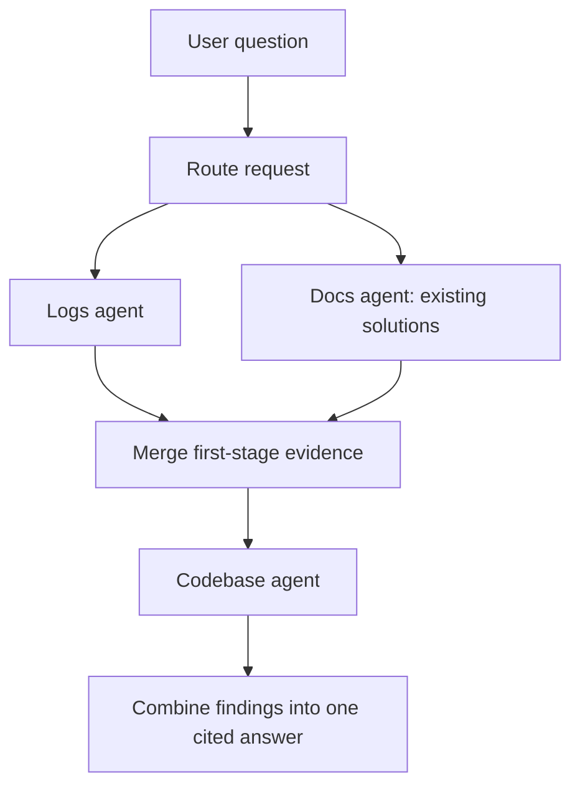

# How the orchestrator works

The orchestrator extends the Sprint 2 FastAPI implementation. It receives a text
question, selects specialist agents, collects their JSON findings, and returns one
answer with source references.

The three specialist roles are **logs**, **docs**, and **codebase**. The codebase
agent uses `code` as its name in the API and JSON contracts.

## 1. Receive the question

Users can enter a question through the terminal chatbot in [chat.py](chat.py), or
send it to `POST /api/ask` in [main.py](main.py):

```json
{
  "question": "Why is checkout returning timeout errors?",
  "incident_id": "INC-42",
  "conversation_id": "conversation-7"
}
```

The API rejects empty questions and questions longer than 2,000 characters. The
incident and conversation IDs are optional correlation metadata; they do not load
stored conversation history.

The question is passed to `investigate()` in [orchestrator.py](orchestrator.py),
which coordinates the remaining steps and creates a request ID for tracing.

## 2. Choose the agents

[classify() in router.py](router.py) examines the question and returns a
`RoutePlan` containing an intent, first-stage agents, second-stage agents, and a
reason for the decision.

| Question type | First stage | Second stage |
|---|---|---|
| Documentation or how-to | Docs | None |
| Code lookup | Docs | Codebase |
| Log lookup | Logs | None |
| Incident | Logs and docs concurrently | Codebase |
| Unclear request | Logs and docs concurrently | Codebase |

For example, "How do I restart checkout?" uses docs, while "Why is checkout
returning timeout errors?" uses all three specialists.

Routing currently uses keyword rules. It does not call an LLM to classify the
question. Unclear requests take the full investigation path to reduce the risk of
skipping useful evidence. `GET /api/route?q=...` exposes the routing plan.

## 3. Delegate the investigation

For an incident question, execution follows this flow:



Logs and docs run concurrently using `asyncio.gather`:

- The logs agent searches for relevant operational errors, events, and patterns.
- The docs agent searches documentation, runbooks, and existing solutions.

After both calls finish or fail, `merge_findings()` combines their successful
summaries, hypotheses, and evidence, along with agent statuses and missing-source
information. The codebase agent receives this evidence bundle with the original
question, so it can use the earlier findings to guide its code/configuration search.

Selective routing and concurrent execution work together: the router chooses which
agents are needed, and the orchestrator runs independent work concurrently.

## 4. Validate the JSON findings and handle failures

[schemas.py](schemas.py) defines the shared contracts:

- `AgentRequest`: question, delegated task, intent, request ID, optional metadata,
  and first-stage evidence when applicable.
- `AgentFinding`: specialist identity, status, summary, hypotheses, evidence,
  sources searched or unavailable, retrieval confidence, and latency.
- `CopilotResponse`: the combined answer returned to the user.

The orchestrator validates each finding and checks that the agent identity matches
the requested specialist. Evidence must have a nonempty summary and source
reference. An `ok` result without evidence becomes `no_evidence`.

Each agent call has a configurable timeout, defaulting to 20 seconds. Timeouts,
connection failures, authentication failures, and malformed responses become
explicit findings rather than stopping the entire investigation. Other specialists
can still contribute, and the response is marked `partial` when sources are missing
or an agent fails.

The orchestrator measures call latency and records an execution trace. It does not
put raw exception messages or remote error bodies into user-facing error responses.

## 5. Return one answer

`synthesize()` in [orchestrator.py](orchestrator.py):

1. Collects evidence from successful findings.
2. Removes duplicates by source type, reference, and link.
3. Preserves source attribution and combines the evidence into one answer.
4. Reports unavailable sources and agents that found no matching evidence.
5. Returns the answer, evidence, findings, agents used, request metadata, and trace
   in a `CopilotResponse` JSON object.

The terminal chatbot prints the answer. API clients receive the structured JSON
response and can display citations and investigation details in their own UI.

## How the specialists connect

[agents.py](agents.py) defines a common interface:

```python
async def run(question: str, context: dict) -> AgentFinding:
    ...
```

The stage logic uses this interface regardless of how a specialist is implemented.

| Adapter | Purpose |
|---|---|
| `LocalSearchAgent` | Searches real files in a configured corpus and returns file/line evidence. |
| `HTTPAgent` | Sends an `AgentRequest` to a configured service and validates its `AgentFinding` JSON. |
| `UnavailableAgent` | Explicitly reports that a specialist has no usable configuration. |

Local mode is the default. Docs and code search this directory unless `DOCS_ROOT`
and `CODE_ROOT` are set. Logs need `LOGS_ROOT` or a remote endpoint.

To connect teammates' services, configure the full POST URLs through
`LOGS_AGENT_URL`, `DOCS_AGENT_URL`, and `CODE_AGENT_URL`. Optional per-agent bearer
tokens are supported. In local mode, a configured URL overrides that specialist's
local adapter. Remote mode disables local fallback.

[agent_service.py](agent_service.py) provides a reference HTTP host for the local
specialists. The original canned scenarios remain available only through explicit
`ORCHESTRATOR_MODE=demo` configuration.

See [COMMUNICATION.md](COMMUNICATION.md) for the exact HTTP payloads and error
behavior, and [README.md](README.md) for setup and configuration commands.

## Current limits

The implemented pipeline uses keyword routing and combines retrieved evidence. It
does not yet use an LLM to reason across findings, establish a root cause, or write
a diagnosis. Retrieval confidence is not treated as a root-cause probability.

The local codebase specialist searches current files and configuration, not git
history. Conversation IDs are forwarded, but conversation history and investigation
state are not persisted across requests.

## Run and verify

From this directory in WSL, using the prepared virtual environment:

```bash
.venv/bin/python chat.py
.venv/bin/python -m pytest -q
```

For a fresh environment, follow [README.md](README.md). The test suite covers
routing, actual file retrieval through the API, concurrent execution, evidence
handoff, JSON validation, partial failures, and all three specialists communicating
over HTTP. At implementation handoff, 51 tests passed on WSL Linux.
