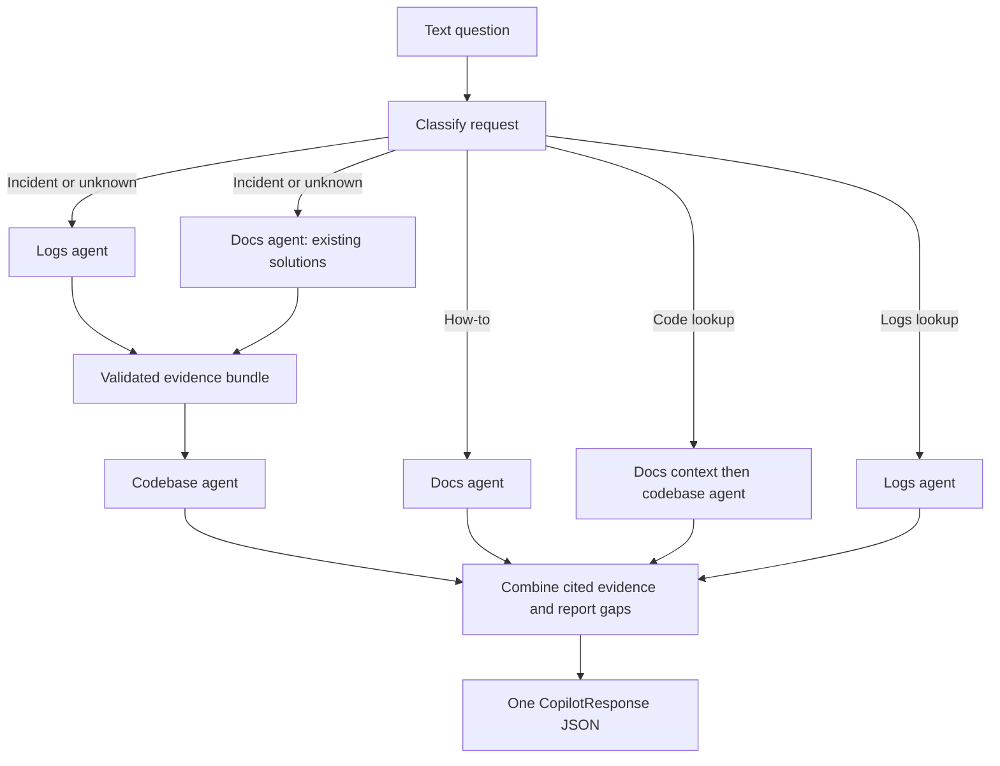

# Selective routing and execution

This implementation follows Option 1 of the supplied architecture diagram. Routing
selects specialists; concurrency is used inside that plan. Selective routing and
parallel execution are compatible.

| Intent | Example | Stage 1 (concurrent) | Stage 2 |
|---|---|---|---|
| incident | Why is checkout timing out? | logs, docs | code |
| how_to | How do I restart checkout? | docs | none |
| how_to | How do I trigger a test failure? | docs | none |
| code_lookup | Where is the retry function defined? | docs | code |
| logs_lookup | Show checkout logs since noon | logs | none |
| unknown | Investigate checkout | logs, docs | code |

Incident symptoms take precedence over generic how-to wording, so "How do I fix
checkout errors?" searches all sources. Explicit instructions for triggering,
injecting, simulating or reproducing failures use docs unless a code search is
requested. Code terms take precedence over generic explanatory wording, so
"Explain the retry function" includes code search. Keyword matching has word
boundaries; unclear intent uses all three specialists. It remains a heuristic,
not a semantic classifier. `GET /api/route?q=...` exposes the plan for evaluation.

## Stages

1. Create a request ID and a route plan. Pass incident/conversation IDs as metadata.
2. Run selected first-stage agents concurrently. Each has a configurable total
   deadline (default 20 seconds), including HTTP and JSON validation.
3. Merge successful summaries, hypotheses and evidence, plus unavailable-source
   metadata and status for every first-stage specialist. Send that bundle to code.
   A failed logs agent does not prevent docs or code from contributing.
4. Validate specialist identities and findings. `ok` without evidence becomes
   `no_evidence`. Error/no-access findings cannot contribute response claims.
5. Deduplicate evidence by source type, reference and link; preserve source
   attribution; return one response, all findings, and timings. Missing agents and
   truncated/unreadable sources mark the answer `partial: true`.

No source match is treated as proof of an incident cause. The live response quotes
retrieved evidence and leaves diagnosis confidence unset. In particular, agent
retrieval confidence is not a probability that a proposed fix will work.

## Adapters

`agents.Agent` defines `async run(question, context) -> AgentFinding`.
`LocalSearchAgent` searches configured corpora. `HTTPAgent` serializes an
`AgentRequest`, POSTs it, and validates `AgentFinding`. `UnavailableAgent` explicitly
reports missing configuration. The orchestrator's stage logic is shared by all
adapters. See [COMMUNICATION.md](COMMUNICATION.md) for exact payloads.

The local code specialist searches current files/configuration, not git history.
Local retrieval scans at most 500 supported files, reads at most 1 MB per file,
returns the four highest-scoring matching files, and has a time deadline. Hidden
entries, symlinks, build/dependency/test directories and `demo_data.py` are skipped.
Search limits and unreadable supported files are reported as gaps. This is a small
working baseline; teammate agents can use their own indexes without changing the
orchestrator flow.

## Investigation state and observability

State is per request: query, route, evidence bundle, findings, IDs and trace. Agent
status and measured latency are logged with the request ID. Questions and remote
error bodies are not logged by the question handler. Conversation IDs are forwarded
but do not restore previous questions or evidence. Durable history, RBAC, audit
storage and monitoring infrastructure from the overall diagram are outside this
one-week integration slice.
