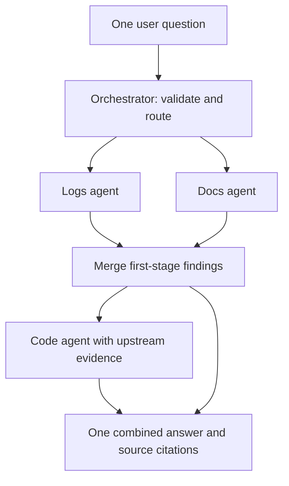

# Weekly sprint demo: one question, three specialists, one response

Use this file as speaker notes. The main walkthrough takes about five minutes.
All commands run in WSL from the orchestrator directory. No Azure credentials or
model calls are required for this demonstration. The source code is unchanged;
the added sprint_demo_data files are clearly labeled synthetic examples.

## What this sprint demonstrates

User story: "As a developer, I want the orchestrator to send my question to the
logs, docs and code agents and combine their answers, so that I get one answer
instead of three."

| Acceptance criterion | Evidence to show |
|---|---|
| Calls logs, docs, and code; at least one working end to end; returns a combined answer | One request to /api/ask calls all three reference HTTP endpoints, retrieves actual example files, and returns one answer plus citations and trace |
| Communication with each agent is documented | COMMUNICATION.md and schemas.py specify the shared contract; DOCS_AGENT_HANDOFF.md gives a teammate implementation guide |
| Starts from Justina's Sprint 2 orchestrator | Show the existing FastAPI entry point, router, staged workflow, and response shape; explain the retrieval/HTTP integration and validation added around that structure |

The demo uses the included reference retrieval specialists hosted in a separate
process. It does not prove the teammates' Azure/Foundry agent deployments have
been connected. If your reviewer requires a teammate-owned service specifically,
replace at least one reference endpoint with that teammate's validated endpoint
and repeat the request before claiming that part is complete.

## Before the presentation: start the services

Use the existing .venv. If dependencies are missing, install requirements.txt into
that environment. Stop any older servers using ports 8000 or 8100 before starting.
Do not open .env on the projector. These commands do not load or need that file.

### Terminal 1: reference agents on port 8100

```bash
cd /home/jonat/CS620/orchestrator
DOCS_ROOT="$PWD/sprint_demo_data/docs" \
LOGS_ROOT="$PWD/sprint_demo_data/logs" \
CODE_ROOT="$PWD/sprint_demo_data/code" \
LOGS_AGENT_TOKEN='' DOCS_AGENT_TOKEN='' CODE_AGENT_TOKEN='' \
.venv/bin/uvicorn agent_service:app --host 127.0.0.1 --port 8100
```

This process exposes /agents/logs/run, /agents/docs/run, and /agents/code/run.
They search separate files under sprint_demo_data. There is no canned final answer.
The input data is synthetic; the retrieval, HTTP requests, validation, and answer
assembly run for real every time.

### Terminal 2: orchestrator API on port 8000

```bash
cd /home/jonat/CS620/orchestrator
ORCHESTRATOR_MODE=remote \
LOGS_AGENT_URL=http://127.0.0.1:8100/agents/logs/run \
DOCS_AGENT_URL=http://127.0.0.1:8100/agents/docs/run \
CODE_AGENT_URL=http://127.0.0.1:8100/agents/code/run \
LOGS_AGENT_TOKEN='' DOCS_AGENT_TOKEN='' CODE_AGENT_TOKEN='' \
.venv/bin/uvicorn main:app --host 127.0.0.1 --port 8000
```

The empty service-token values keep this loopback-only reference demo independent
of previously exported teammate credentials. All assignments apply only to the
command they precede. No model or source credentials are changed.

### Optional terminal 3: existing frontend

```bash
cd /home/jonat/CS620/frontend
VITE_API_URL=http://127.0.0.1:8000 npm run dev
```

If its dependencies are not installed yet, run npm ci in frontend first.
Open http://localhost:5173 and keep http://127.0.0.1:8000/docs in a second tab.

The current frontend has a fixed Demo responses badge and an empty incident list
that appears to stay loading in remote mode. You can still type a question. Explain
that the badge is old presentation text; /api/health reports the actual backend mode.
For incident questions, DiagnosisCard does not render response.answer, so use /docs
for the full combined incident response. The frontend question below uses its normal
answer view and displays the answer text.

## Five-minute presentation: what to show and what to say

### 0:00-0:40 -- introduce the goal

Show this user story and the architecture below.

Say:

> My sprint focused on the coordination layer. The goal is for a developer to ask
> one question and receive one response backed by logs, documentation, and code,
> instead of contacting each specialist separately. I started from Justina's
> Sprint 2 FastAPI orchestrator and extended its agent connections and validation.



### 0:40-1:00 -- show which services are connected

Open http://127.0.0.1:8000/api/health.

Point out mode=remote and HTTPAgent for logs, docs, and code.

Say:

> The orchestrator is configured to call three HTTP endpoints. For this demo,
> these are our reference specialists running in a separate process. Each searches
> a small source collection. This confirms the connection configuration; the next
> request will demonstrate that the calls actually succeed.

### 1:00-2:00 -- ask one question and show one response

In the frontend, enter exactly:

```text
Investigate checkout
```

This takes the router's unknown-intent fallback, which runs the full pipeline.
It produces kind=answer, allowing the existing frontend to display the combined
answer. The initial trace explains the fallback; do not call it model-based routing.

Show the answer and the Sources section. Expand evidence as needed to display
three source types: logs, docs, and code. Under this controlled corpus, expect one
source file from each specialist, though the best-matching excerpt can vary by query.

Say:

> I submit one question. The orchestrator selects the full investigation path and
> returns one response containing findings from all three specialists. These are
> retrieved excerpts from the example log, runbook, and configuration file. The
> example incident data is synthetic; the response is assembled from the files
> rather than selected from a stored final diagnosis.

Open the three files to show what the agents retrieved:

- sprint_demo_data/logs/checkout.log: a timeout event with elapsed_ms=2100.
- sprint_demo_data/docs/checkout.md: guidance to compare latency and timeout settings.
- sprint_demo_data/code/checkout.toml: request_timeout_seconds = 2.

Say:

> The evidence gives us a useful investigation lead, but it does not by itself prove
> a production root cause. This version preserves that distinction.

### 2:00-2:40 -- show the investigation trace and HTTP calls

Expand "How Copilot investigated" in the frontend.
Point to the routing event, logs/docs in stage 1 marked parallel, code in stage 2,
and final combination event. Then show Terminal 1's access log: successful POSTs
to all three /agents/.../run endpoints. The order of logs and docs can vary.

Say:

> Logs and docs run concurrently because neither depends on the other. After that
> stage, their successful evidence is merged and supplied to the code agent with
> the original question. The final response keeps source attribution and a trace.
> The trace is returned after completion; it is not a stream of live progress events.

The local code search uses terms from the upstream evidence to guide its search.
A teammate's model-powered code agent can consume the same evidence_bundle contract.

### 2:40-3:20 -- show the API response and input validation

Open /docs -> POST /api/ask -> Try it out. Use:

```json
{
  "question": "Why is checkout returning timeout errors?",
  "incident_id": "SPRINT-DEMO",
  "conversation_id": "sprint-presentation"
}
```

Execute it. Show answer, agents_used, evidence, findings, partial, demo, and trace.
Expected: all three findings have status=ok, partial=false, and demo=false. This
question routes explicitly as an incident. It uses the same /api/ask endpoint as
the frontend, but /docs displays all fields the older UI may omit.

Say:

> The browser sends an AskRequest JSON object. FastAPI parses the fields, and the
> API rejects blank questions or questions longer than 2,000 characters. Routing
> currently uses keyword rules. The IDs are for correlation; they do not load chat
> history. The API returns a single CopilotResponse containing the combined answer
> and the individual findings for inspection.

### 3:20-4:10 -- explain the code in four stops

Open each location briefly rather than scrolling through every line:

| Location | What to point out | What to say |
|---|---|---|
| main.py: ask | Input validation and investigate(...) | This is the frontend's entry point. |
| orchestrator.py: investigate | classify, stages, asyncio.gather, evidence_bundle | This coordinates the calls and their dependencies. |
| agents.py: HTTPAgent.run | AgentRequest, client.post, AgentFinding validation | This sends the shared JSON contract to a configured specialist endpoint. |
| orchestrator.py: synthesize | Successful findings, citation deduplication, partial response | This combines validated evidence into one response and identifies missing sources. |

Also point to call_agent if asked about robustness: it handles timeouts, invalid
JSON, wrong agent identities, and HTTP errors without discarding other agents' work.

### 4:10-4:40 -- demonstrate documented communication

Open COMMUNICATION.md, then schemas.py. Show AgentRequest, AgentFinding, and Evidence.
Briefly show DOCS_AGENT_HANDOFF.md for your teammate's implementation instructions.

Say:

> All three specialists use the same versioned request and response structure.
> Requests contain the question, specialist task, intent, request metadata, and any
> upstream evidence. Responses identify the agent and include a status, summary,
> hypotheses, evidence with exact references, and missing-source information. Each
> agent can use its own model and retrieval system behind this common interface.

### 4:40-5:00 -- close with scope and next steps

Say:

> This demonstrates all three reference agents working end to end through HTTP,
> with one combined answer and documented contracts. The next integration step is
> replacing the reference endpoints with the teammates' services. AI-generated
> final explanations are a separate next step; the current orchestrator combines
> retrieved evidence without an LLM. The Azure credentials in my local environment
> have not been wired into this orchestration path yet.

## Optional extra minute: show failure handling

Stop the reference-agent process in Terminal 1 using Ctrl+C; leave the orchestrator
running. Repeat the /api/ask request through /docs. It should return a response with
partial=true, error findings, and unavailable-source information instead of an
unhandled API crash. This stops all three reference endpoints together.

Say:

> Agent connection failures become structured results. The response reports what
> was unavailable. When some specialists still succeed, their evidence is retained;
> this particular demonstration stopped the shared host, so all three are unavailable.

Restart Terminal 1 with its original command and repeat the request to show recovery.
For a one-agent-failure demonstration, use independent agent hosts or the automated
partial-failure tests rather than claiming the shared-host shutdown affects only one.

## Questions you might be asked

**Is this using my teammates' real agents?**

> This run uses reference HTTP services and real retrieval over synthetic example
> files. The teammate services can replace them by implementing the documented
> interface and updating the endpoint settings. Their deployments are not yet
> verified by this run.

**Is the response hardcoded?**

> The example source data is prepared and labeled synthetic. In this run, the
> agents search those files and the orchestrator combines the returned findings.
> ORCHESTRATOR_MODE=demo is a separate mode with stored scenario answers; this run
> uses remote mode and returns demo=false.

**Where does AI fit?**

> A specialist can use an AI model internally while returning AgentFinding. We can
> also add an optional model call after validated evidence is collected. That call
> would generate an explanation while preserving the cited evidence. Neither is
> necessary to demonstrate this reference integration.

**How do you know the code agent receives earlier evidence?**

> investigate assigns merge_findings(findings) to context.evidence_bundle before
> stage 2. HTTPAgent serializes it into AgentRequest. The concurrency-and-handoff
> test verifies the content received by the code agent; the real-HTTP test covers
> all three reference endpoints.

## Rehearsal and acceptance checklist

- Run .venv/bin/python -m pytest -q before presenting.
- Confirm both backend processes start without port conflicts.
- Confirm /api/health reports remote mode and three HTTPAgent adapters.
- Submit the question; confirm all three findings are ok and evidence has all three types.
- Point to the single answer field, citations, and the execution trace.
- Show the three successful reference endpoint requests in Terminal 1.
- Open COMMUNICATION.md, schemas.py, and DOCS_AGENT_HANDOFF.md.
- Describe reference services, synthetic inputs, teammate integration, and AI scope accurately.
- The new files are local until committed and pushed; staging alone does not publish them.

If the frontend is unavailable, use /docs for the full demonstration. The API is
the integration boundary, and /docs exercises the same /api/ask request.
